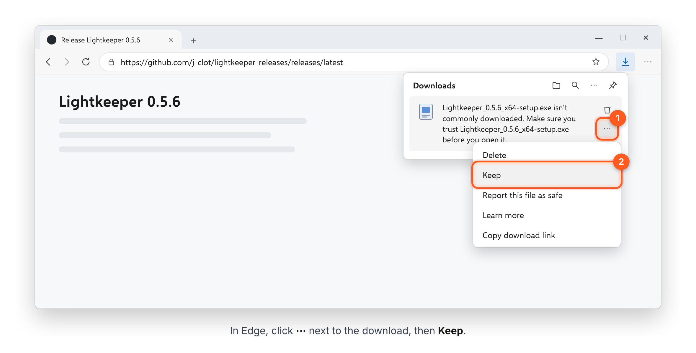
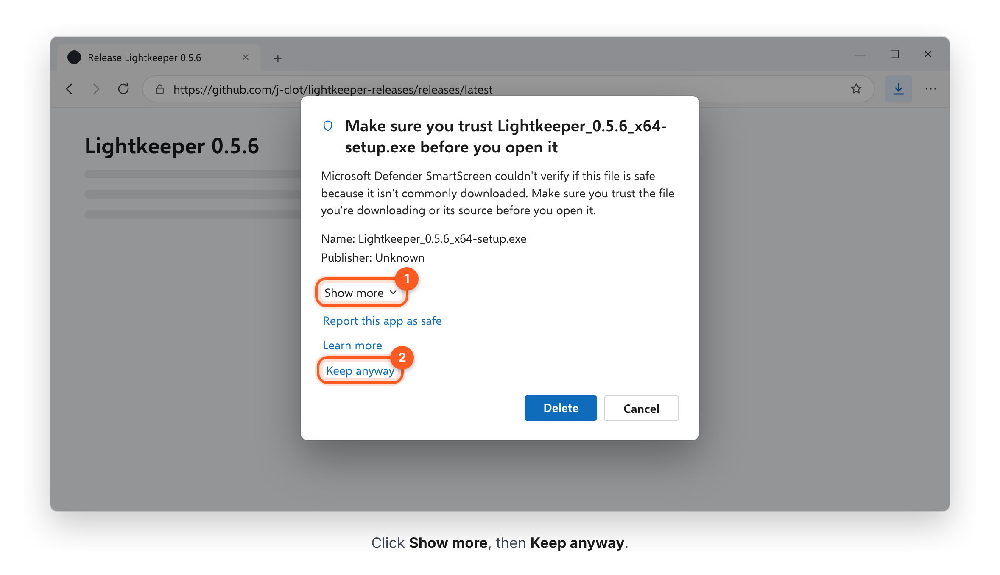
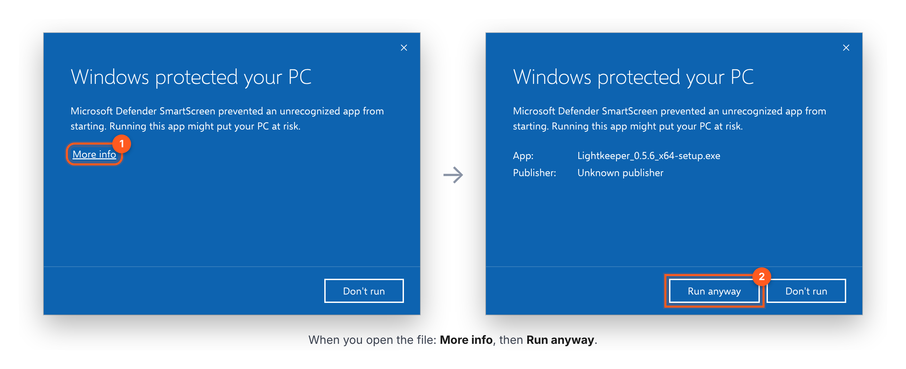
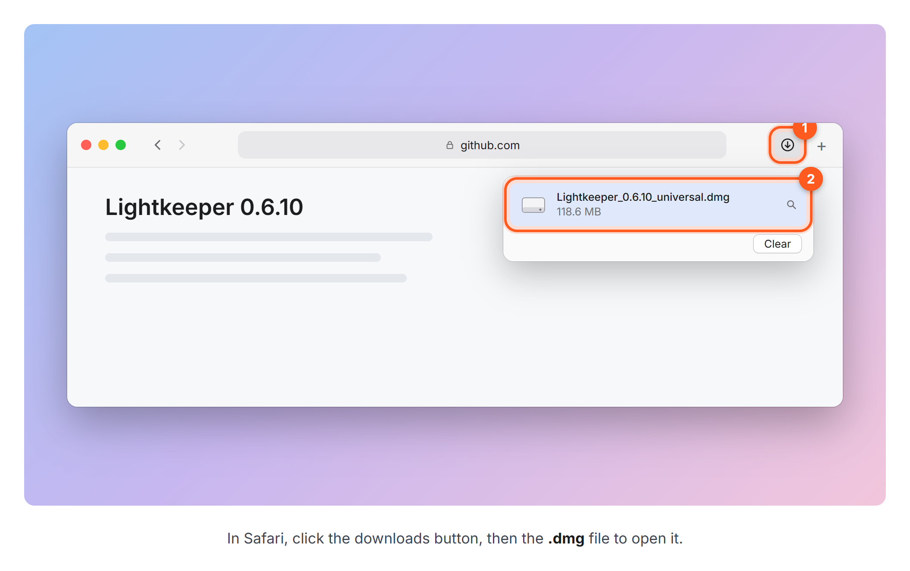
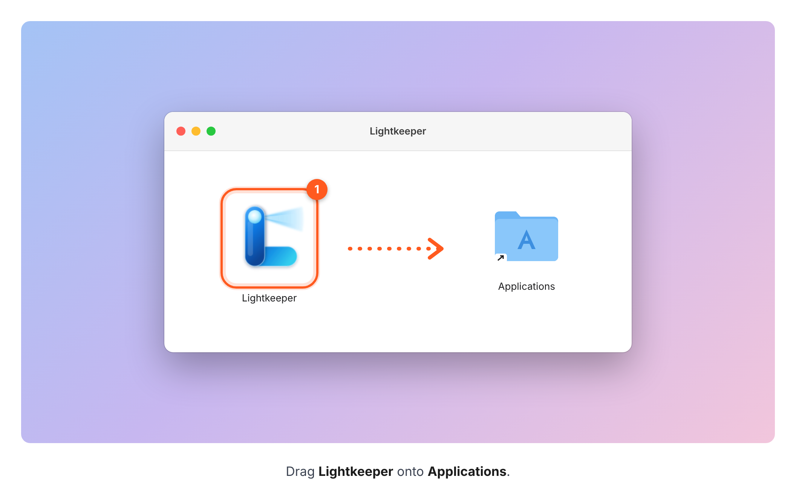
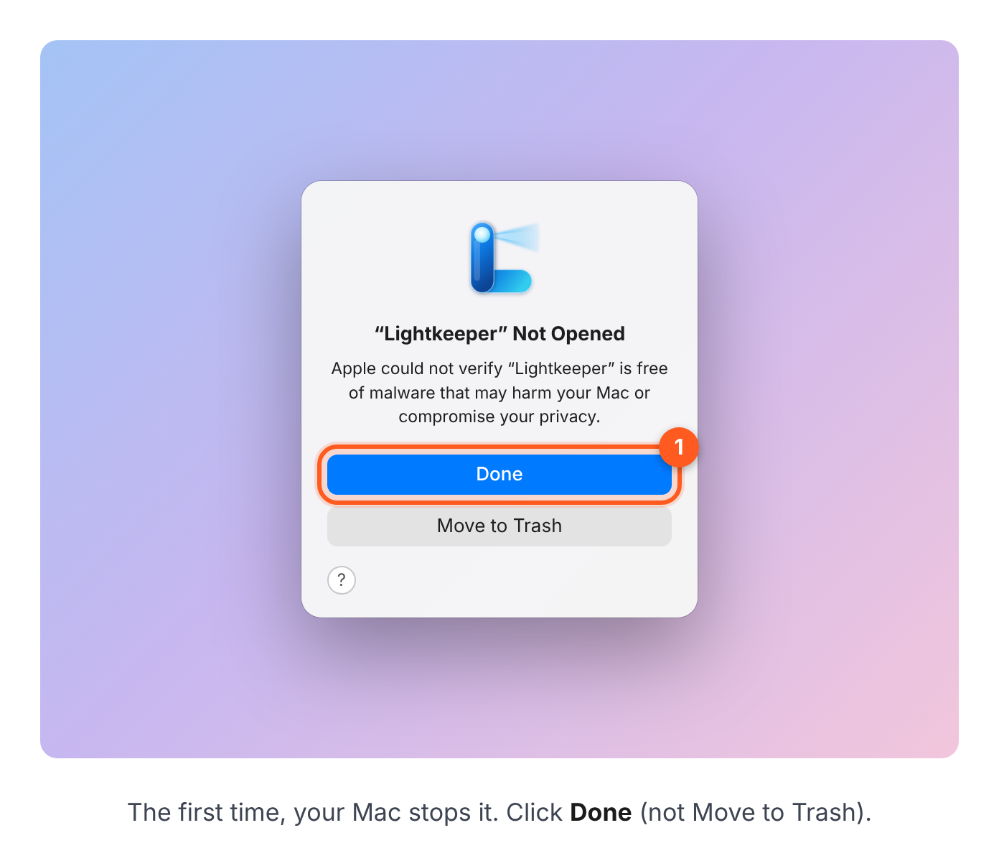
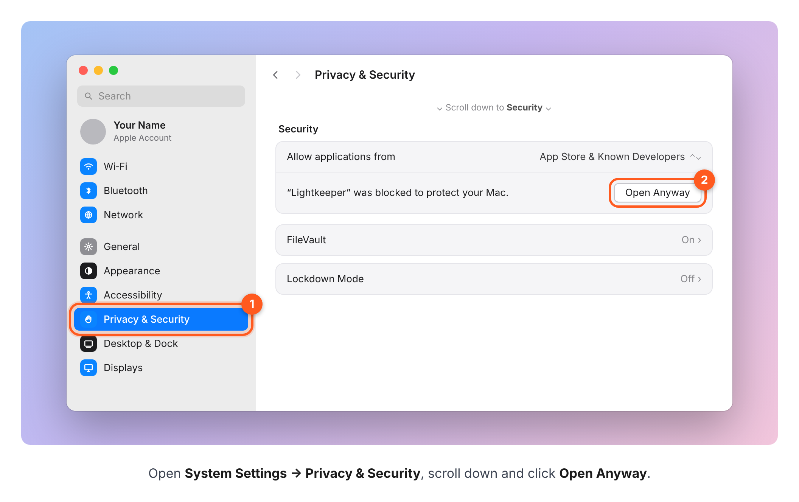
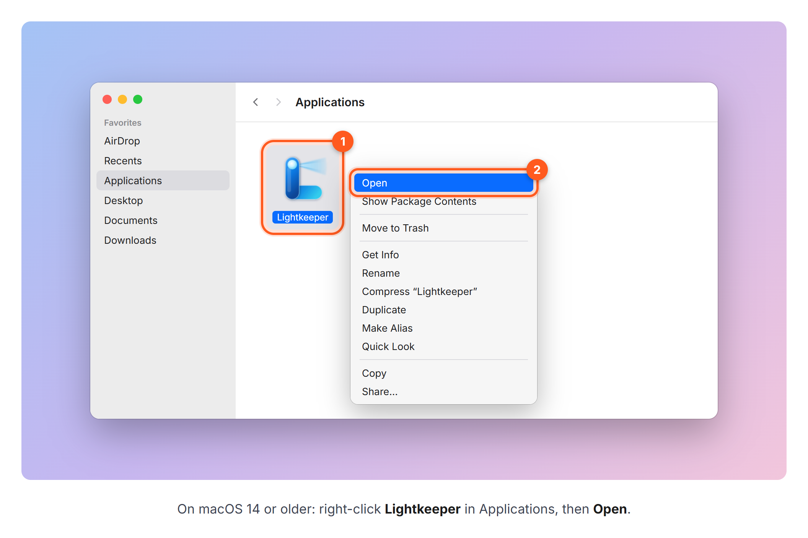

# Lightkeeper

Lightkeeper is a desktop companion for Lighthouse Studio.

## [Download the latest version](https://github.com/j-clot/lightkeeper-releases/releases/latest)

**Already using Lightkeeper? You don't need to do anything.** It updates itself the next time you open it.

**Installing it for the first time?** Open the link above and follow the steps for your computer. You only do this once.

### Windows

1. On that page, under **Assets**, click the file ending in **x64-setup.exe** to download it.

2. Edge may hold the download and say it *"isn't commonly downloaded"*. That's normal for an app made in-house. Click **⋯** next to the file, then **Keep**.

   

3. If Edge asks again, click **Show more**, then **Keep anyway**.

   

4. Open the downloaded file. If a blue window says **Windows protected your PC**, click **More info**, then **Run anyway**.

   

   If there's no **Run anyway** button, your PC has *Smart App Control* turned on and won't let you install apps that aren't from a big software company. Ask IT to install Lightkeeper for you.

5. Lightkeeper installs and opens by itself. From now on you'll find it in the Start menu.

### Mac

Works on any Mac with macOS 13.3 (Ventura) or newer, Apple silicon or Intel. If your Mac has an older version, update macOS first (Software Update).

1. On that page, under **Assets**, click the file ending in **universal.dmg** to download it. When it has finished, open it from your browser's downloads.

   

2. A window opens with Lightkeeper and the Applications folder. Drag **Lightkeeper** onto **Applications**.

   

3. Open Lightkeeper from your **Applications** folder. The first time, your Mac stops it because it doesn't know who made it. Click **Done** (not Move to Trash).

   

4. Open **System Settings**, click **Privacy & Security** and scroll down to **Security**. Next to *"Lightkeeper was blocked to protect your Mac"*, click **Open Anyway**. Click **Open Anyway** once more and type your Mac password.

   

5. Lightkeeper opens. From now on it opens normally.

**On macOS 14 Sonoma or older**, steps 3 and 4 are simpler: right-click Lightkeeper in Applications, choose **Open**, then click **Open** in the message that follows.

   

### Why all these warnings?

Windows and macOS show them for any app that doesn't come from a big software company. Lightkeeper is our own tool, so this is expected. You only see them **the first time**: after that, Lightkeeper updates itself.

### Good to know

- **Which file do I need?** Just one: the `.exe` on Windows or the `.dmg` on a Mac. Ignore everything else: `latest.json`, the `.sig` and `.tar.gz` files are what Lightkeeper reads to update itself, and the two **Source code** links are added by GitHub to every release (they hold only this page's pictures, not the app).
- **Updates are automatic.** When there's a new version, Lightkeeper installs it the next time you open it. If you're in the middle of something, it asks before restarting, so you never lose unsaved work. You can turn this off in **Me → Settings → Updates**.
- **On a Mac**, everything that needs Lighthouse Studio (which only runs on Windows) isn't available.
